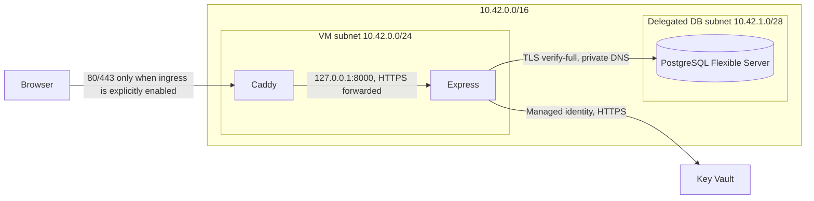

# Azure VM Architecture Candidate

**Status: NO-GO.** This is an offline architecture candidate for owner review. It creates no Azure resources, changes no billing settings, and does not authorize deployment. The readiness manifest remains disabled with all six gates blocked.

## Decision

The candidate is one Linux `Standard_B2ats_v2` VM running Caddy and the existing Node.js 24 / Express application, with Azure Database for PostgreSQL Flexible Server 17 (`Standard_B1ms`) on a separate private delegated subnet. A single Standard static IPv4 is conditional on `enablePublicIngress=true`; the committed default is `false`. PostgreSQL has no public endpoint. There is no NAT Gateway, load balancer, Front Door, Application Gateway, Bastion, paid monitoring workspace, or container registry in this cost baseline.

The <$5/month target is **not a reliable all-in target**. At the observed Poland Central retail rates, the list-price subtotal is about **$45.70/month** before Private DNS, Key Vault operations, egress, logging, backups above allowance, or administrative access. If every applicable 12-month VM and PostgreSQL free allowance is still available and applies to this subscription, the static IP plus one Private DNS zone are roughly **$4.88/month**, leaving almost no room under $5 for those other meters. The owner reports an $88 credit balance expiring 2027-10-14; we did not inspect the subscription and cannot verify the balance or expiry. Microsoft currently lists 750 hours of B2ats v2 VM, 750 hours of PostgreSQL B1MS, 32 GB PostgreSQL storage and 32 GB backup per month for 12 months; this page does not prove this account's remaining eligibility. The Microsoft marketplace VM offer separately describes two P6 64-GiB disks; the owner also reports the portal shows this allowance. [Azure for Students](https://azure.microsoft.com/en-us/free/students/) · [Microsoft free-account VM offer](https://marketplace.microsoft.com/en-us/product/microsoft.freeaccountvirtualmachine-linux?tab=Overview)

## Topology

The VM NSG allows inbound TCP 80/443 from the Internet and TCP 22 from the explicitly supplied administrator IPv4 `/32`; the SSH parameter defaults to `127.0.0.1`, so it is unusable remotely until an owner supplies a narrow address in a future reviewed deployment. A Standard public IP is created only when public ingress is enabled. Outbound rules allow Azure DNS, PostgreSQL to the DB subnet, HTTPS/HTTP to the Internet for bootstrapping and updates, and NTP; a lower-priority explicit deny blocks other outbound flows. PostgreSQL remains on a delegated `/28` with private DNS, TLS required, 7-day backup retention, no geo-redundancy, no HA, and no storage auto-growth. PostgreSQL's delegated subnet NSG allows port 5432 within the subnet and from the VM subnet and allows port 443 to the Storage service tag for WAL archival, as Microsoft requires when restricting those flows. [PostgreSQL private networking](https://learn.microsoft.com/en-us/azure/postgresql/flexible-server/concepts-networking)

The VM uses Ubuntu 24.04, a 64-GiB Premium_LRS P6 OS disk, Trusted Launch, Secure Boot, vTPM, boot diagnostics, and delete-with-VM disk behavior. The VNet uses `10.42.0.0/16` as an example only; overlap with existing networks must be checked. The VM NIC has no public IP in the committed default. Azure's current outbound-access design requires explicit egress for new private subnets, so boot/update access relies on the conditional direct public IPv4 in this candidate. A private-only VM would require a separately designed and priced operator/egress path. [Azure outbound egress design](https://learn.microsoft.com/en-us/azure/networking/design-guide/outbound-egress) · [Default outbound access](https://learn.microsoft.com/en-us/azure/virtual-network/ip-services/default-outbound-access)

## Cost worksheet

Price snapshot date: **2026-10-16**. Rates are USD list-rate observations from the unauthenticated Azure Retail Prices API, `armRegionName=polandcentral`, multiplied by 730 hours for a continuous 30.4-day month. They are not a subscription quote; offer, currency, tax, exact SKU availability, and student entitlements can change the bill. [Azure Retail Prices API](https://learn.microsoft.com/en-us/rest/api/cost-management/retail-prices/azure-retail-prices)

| Meter | Observed price | 730-hour / 32-GB example |
| --- | ---: | ---: |
| Linux B2ats_v2 compute | $0.0108/hour | $7.88 |
| Premium SSD P6 64-GiB managed disk | $11.227/month | $11.23 |
| PostgreSQL B1MS compute | $0.0199/hour | $14.53 |
| PostgreSQL storage, 32 GB | $0.137/GB-month | $4.38 |
| PostgreSQL backup, 32 GB | $0.103/GB-month | $3.30 |
| Standard static public IPv4 | $0.006/hour | $4.38 |
| **Subtotal before DNS and operations** | | **$45.70/month** |

One Private DNS zone is $0.50/month at the observed retail rate; private queries are $0.40 per million, and private record sets have a separate meter above the included tier. Standard public IPv4 pricing is usage-metered; detaching/stopping the VM does not necessarily stop address charges while the address remains allocated. The observed Internet egress meter had the first 100 GB tier at $0 and the next tier at $0.08/GB; the tier applies to eligible bandwidth billing and is not a promised subscription exemption. Key Vault Standard secret operations are about $0.03 per 10,000 operations. These variable meters are excluded from the base subtotal and must be forecast for the chosen offer. [Public IP pricing](https://azure.microsoft.com/en-us/pricing/details/ip-addresses/) · [Private DNS pricing](https://azure.microsoft.com/en-us/pricing/details/dns/) · [Retail Prices API](https://learn.microsoft.com/en-us/rest/api/cost-management/retail-prices/azure-retail-prices)

| Scenario | Approximate monthly amount | What it means |
| --- | ---: | --- |
| All listed compute, disk, database, backup, IP and zone at observed rates | $46.20 | Before Key Vault, egress, monitoring, restore overlap, and bootstrap/SSH costs |
| VM compute, P6, and PostgreSQL meters covered by remaining eligible grants | $4.88 | IP plus estimated zone only; leaves ~$0.12 for all other usage and is not a safe cap |
| After free allowances expire, same footprint | At least $46.20 | Excludes variable and owner-operation costs |

The VM runs 730 hours per month, within the advertised 750-hour threshold only when the account remains eligible. The same account-specific check is required for the PostgreSQL allowance and disk offer. Credit is not a spending limit: a budget creates alerts, and some charges can remain possible despite a spending limit. Keep auto-growth disabled, no paid restore copy online except during a separately approved drill, and define an owner-held budget/cleanup calendar before any future deployment.

Azure managed disks use platform-managed server-side encryption at rest by default. The VM template also enables encryption at host to cover temporary disks and disk caches, using platform-managed keys without an added charge or guest CPU cost. Before deployment, the owner must verify `EncryptionAtHostSupported=True` for `Standard_B2ats_v2` in the chosen subscription and region through the Azure Resource SKU API; this check was not possible without subscription access. If the selected SKU or region does not support it, keep deployment blocked and choose a supported size or explicitly revise the security decision. [Managed disk encryption](https://learn.microsoft.com/en-us/azure/virtual-machines/disk-encryption) · [Check encryption-at-host SKU support](https://learn.microsoft.com/en-us/azure/virtual-machines/linux/disks-enable-host-based-encryption-cli)

The less-than-$5 proposal is therefore only a narrow hypothetical when all major compute/storage allowances are valid. It is not feasible as a dependable all-in architecture with public access, backup, DNS, Key Vault, egress, and maintenance. The Azure for Students free-service list currently documents PostgreSQL's 750 B1MS hours, 32 GB storage, and 32 GB backup allowance; it does not remove the need to verify per-subscription balances, dates, quotas, and regional capacity. [Students free-services list](https://azure.microsoft.com/en-us/free/students/) · [Spending limits](https://learn.microsoft.com/en-us/azure/cost-management-billing/manage/spending-limit)

## Runtime and release design

Cloud-init creates a non-login `vinyl` service account, installs Node.js 24 and Caddy from signed HTTPS apt repositories, writes systemd units, and starts Caddy. It does not contain database/session secrets or install the application release. The template does not run migrations, create PostgreSQL logins, seed data, configure a GitHub runner, or fetch source code. A future approved release procedure must place a verified immutable Linux package at `/opt/vinyl-shop/current`, verify the official PostgreSQL CA bundle, then restart the app service. Node's 24.x repository and Ubuntu's `latest` image are major-track inputs, not patch-level pins; capture exact package/image versions and test security updates before production use.

The app binds to `127.0.0.1:8000` only when `APP_BIND_ADDRESS=127.0.0.1` is explicitly set; the existing App Service baseline leaves that variable unset and keeps its platform listener behavior. The VM uses `SESSION_PROXY_MODE=verified-proxy` and trusts only `127.0.0.1/32`. Caddy terminates TLS and reverse-proxies to Express. Caddy documents that it ignores client-supplied forwarding values and sets forwarding headers from the direct connection unless trusted upstream proxies are configured; none are configured here. [Caddy reverse proxy](https://caddyserver.com/docs/caddyfile/directives/reverse_proxy)

A local Caddy-container smoke test used a fictional upstream fixture over both HTTP and TLS while sending spoofed `X-Forwarded-Proto`, `X-Forwarded-For`, and `X-Forwarded-Host`. The upstream saw the actual HTTP/HTTPS scheme and did not receive the supplied visitor IP or forged host as authoritative forwarding values. This verifies Caddy's local behavior only; it does not test Azure's ingress chain or prove that the deployed VM is unreachable by a direct backend route.

This provides an HTTPS peer boundary for Express but does not solve the current abuse-protection question: every client reaches Express through the same local Caddy socket peer, and the application intentionally keys abuse limits on that peer. Login and registration budgets would therefore be shared by all visitors on this single VM. Do not change rate-limit identity or trust client IP headers to make the demo appear ready. Measure legitimate-user and hostile-load behavior in an authorized isolated environment first.

The VM's B2ats_v2 size has 1 GiB RAM. In a local Docker container limited to 1 GiB, the allowlisted runtime package ran on Node 24 with Caddy, loopback Express binding, and a separate disposable PostgreSQL 17 container using verified TLS. After startup and 100 sequential `/health/ready` plus `/api/products` requests, Docker reported **102.1 MiB / 1 GiB** for the app+Caddy container. This smoke workload did not exercise sustained login/bcrypt or parallel abuse traffic, and it excludes Azure guest-agent/kernel overhead, so it is not enough to approve the 1-GiB SKU. A margin below available memory is required; if representative login/cart/admission-control load approaches the limit, this SKU is not acceptable.

## Key Vault and database bootstrap

The system-assigned VM identity receives only Key Vault Secrets User on this vault. The vault uses RBAC, purge protection, seven-day soft-delete retention, default-deny network ACLs, no IP allow rules, and a VM-subnet service endpoint rule. At boot, a bounded helper obtains a managed-identity token from IMDS, reads only named runtime secrets, and writes a root-owned environment file readable by the `vinyl` group. Values are never printed. A retrieval failure leaves the app stopped. Review Key Vault VNet rules and startup behavior with non-secret probes before clearing any gate.

The Bicep candidate creates the empty `vinyl_shop` database but does not initialize app/session/abuse tables or create the least-privilege runtime LOGIN. The administrator parameter is secure, but it is not populated or logged here. Bootstrap remains a separate owner-authorized operation from a private environment with verified TLS. Use the documented application/session/abuse initializers once, create separate migration and runtime identities, apply reviewed grants, confirm denial of DDL/product writes, and write runtime secrets through the approved secret-manager path. A public GitHub runner cannot reach this private PostgreSQL server. Never open database public access to work around the missing path.

PostgreSQL connections use its official hostname with `sslmode=verify-full` and the packaged trusted root bundle. `require_secure_transport` is on. No `NODE_TLS_REJECT_UNAUTHORIZED`, `sslmode=require`, or plaintext fallback is allowed.

## Operations, recovery, and cleanup

### Administration and updates

- Open SSH only from the current operator's public IPv4 `/32`, use a dedicated key, and remove the rule after the task. Never use `0.0.0.0/0`, password SSH, or commit private keys.
- The current candidate provides no Bastion or VPN. Bastion Developer is not available in Poland Central and paid access options change the cost case; select and price an owner-approved access path before deployment. [Bastion SKU/region comparison](https://learn.microsoft.com/en-us/azure/bastion/bastion-sku-comparison)
- Review Ubuntu, Node 24, Caddy, and npm dependency security updates on a regular owner schedule. Stage package upgrades, check service status and `/health/ready`, then restart. Keep a previous verified app package for rollback. Cloud-init package sources track current repository packages, so reconstructing an identical VM later is not guaranteed.
- Caddy obtains/renews the public certificate for the owner-supplied domain; port 80 and 443 must reach the VM for the documented HTTP challenge flow. Verify renewal logs and HTTPS behavior without recording secrets or user data.
- Watch VM memory/CPU credits, disk, PostgreSQL storage/connections, failed Key Vault fetches, TLS expiration, backup age, and Azure spend. A lightweight local journal is not a durable monitoring system; no paid Log Analytics or alert workspace is included.

### Backup, restore, and rollback

- PostgreSQL has seven-day platform backup retention, but no regionally redundant backup. Verify actual restore points privately before relying on them.
- Authorize a PITR drill separately. Restore into an isolated server, run schema/privilege/application checks with fictional data, confirm old sessions are invalidated as required, record measured RPO/RTO and cost, then delete the restore resources after owner review.
- For an application rollback, restore the previous immutable package, restart `vinyl-shop`, and confirm both liveness and DB-backed readiness. Avoid schema rollback unless the migration has a separately reviewed, tested reverse procedure.
- Restoring a VM disk does not replace the PostgreSQL restore procedure. Do not treat boot diagnostics or application logs as a database backup.

### Deletion and budget controls

Before creating anything, inventory and owner-tag every billable resource. At shutdown, stop traffic, preserve any required PostgreSQL recovery point, delete the VM and its OS disk/NIC/public IP, then delete PostgreSQL only after the owner approves data disposition. Remove VNet, NSGs, DNS link/zone, and Key Vault only after references and recovery needs are reviewed. Key Vault soft-delete and purge protection can retain a deleted vault; do not purge it as part of routine cleanup. Check Cost Management after deletion for lingering public IP, disk, backup, DNS, and soft-deleted-vault charges. Leave student spending protection active and never auto-upgrade to pay-as-you-go.

## Validation and remaining gates

Offline validation compiles both the established App Service Bicep and this VM candidate, lints the candidate, and checks the compiled ARM shape for secure defaults and cost-sensitive exclusions. It does not prove provider acceptance, regional capacity, Azure policy compatibility, network reachability, package installation, live certificates, Managed Identity/Key Vault integration, memory margin, or restore success.

The following remain blocked: immediate proxy/health/browser behavior in the target Azure topology; shared-peer abuse impact; student eligibility, quotas and capacity; full account-specific cost approval; private bootstrap, least-privilege DB roles and secret resolution; and a separately authorized Azure PITR/rollback drill. Keep `infra/azure/readiness.json` untouched until each has current independent evidence and a separately reviewed activation decision.
